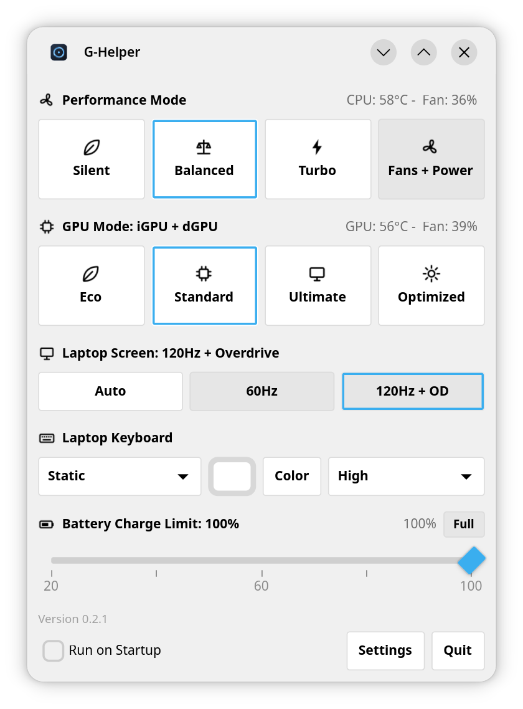

# g-helper-linux

A lightweight, native control centre for ASUS laptops on Linux — a small
G-Helper style front end for **asusd** (asusctl) and **cardwire**.
The interface mirrors G-Helper's compact Windows layout and follows the
desktop light/dark preference.

It is **not** a driver, daemon replacement or firmware tool. It asks the
existing Linux services to do the work, exactly like G-Helper asks the ASUS
System Control Interface on Windows.




## What it does

| Area | Backend | Notes |
| --- | --- | --- |
| G-Helper-style main window | GTK4 + CSS | Compact mode rows, light/dark, live CPU/GPU header stats |
| Silent / Balanced / Turbo profiles | `asusd` → `xyz.ljones.Platform` | Same BIOS profiles as Armoury Crate |
| AC / battery profile automation | `asusd` | Toggle asusd's automatic switching (Settings) |
| Custom fan curves per profile | `asusd` → `xyz.ljones.FanCurves` | Drag-and-drop RPM charts, named presets, copy between profiles, JSON import/export; CPU, GPU and MID fans |
| CPU boost / energy preference | `asusd` | Per-profile EPP in Fans + Power |
| PPT power limits | `asusd` → asus-armoury attributes | Vertical sliders with Applied/Not Applied status |
| GPU modes (Eco / Standard / Ultimate / Optimized) | `cardwire` + asusd | Runtime blocking plus firmware MUX/ECO |
| Per-app dGPU launch | `cardwire launch` | Start chosen apps with the dGPU available while Smart mode keeps it blocked elsewhere |
| dGPU disable + GPU MUX | `asusd` → firmware attributes | Queued; requires a reboot |
| Panel overdrive | `asusd` → firmware attributes | Tied to the 120Hz + OD button |
| Refresh rate + Auto | `kscreen-doctor` (KDE Plasma) | Auto switches 60/max on AC changes while running |
| Keyboard lighting | `asusd` → `xyz.ljones.Aura` | Brightness, effect mode, colour and animation speed |
| Battery charge limit / one-shot full charge | `asusd` | Restored by asusd after suspend/reboot |
| Battery readout | sysfs | Charge %, charge/discharge watts and rough time remaining in the window and tray tooltip; health, capacity and cycles in Settings |
| Fn / ROG key mappings | evdev (passive read) | Map keys in Settings → Hotkeys; needs the bundled udev rule |
| Opens next to the taskbar | KWin scripting (Plasma) | Uses the work area, so top/bottom/left/right panels all work |
| Live temperatures and fan percentages | sysfs / `/proc` | dGPU asleep is reported honestly |
| Tray icon and quick profile switch | StatusNotifierItem + dbusmenu | Live tooltip; KDE Plasma, GNOME needs an extension |
| Single-instance window routing | GApplication command line | `--page`/`--minimized` reach the running window |
| Window geometry and start-hidden | `~/.config/ghelper-linux/ui.json` | Size, maximised state and tray startup |
| Background automation | optional user service | cardwire GPU mode + refresh rate (opt-in) |

## Requirements

- Linux with `asusd` from [asusctl](https://gitlab.com/asus-linux/asusctl)
  running (`systemctl status asusd`). Your user must be allowed to talk to it
  (the default policy allows the `wheel` group).
- Python 3.10+, PyGObject, GTK 4 and libadwaita.
- [cardwire](https://github.com/OpenGamingCollective/cardwire) + `cardwired`
  for GPU modes (optional but recommended).
- KDE Plasma for refresh-rate switching; other desktops get the rest of the
  app and a clear "not available" note.

### Fedora

```bash
sudo dnf install python3-gobject python3-dbus gtk4 libadwaita asusctl
sudo dnf install cardwire        # if your repos carry it, otherwise see cardwire docs
```

### Arch

```bash
sudo pacman -S python-gobject python-dbus gtk4 libadwaita asusctl
# cardwire: see https://opengamingcollective.github.io/cardwire
```

## Install

From this checkout:

```bash
sudo make install          # or: sudo ./install.sh
ghelper-linux
```

Both install to `/usr` by default; override with `PREFIX=/usr/local`.

Or run without installing:

```bash
./run.sh
PYTHONPATH=src python3 -m ghelper --debug
```

There is also an RPM spec in `packaging/ghelper-linux.spec` for Fedora
packaging.

### Build an RPM

```bash
sudo dnf install rpm-build make
mkdir -p ~/rpmbuild/{SOURCES,SPECS}
tar --transform 's,^\.,ghelper-linux-0.1.0,' \
    --exclude='__pycache__' --exclude='*.pyc' \
    -czf ~/rpmbuild/SOURCES/ghelper-linux-0.1.0.tar.gz .
rpmbuild -ba packaging/ghelper-linux.spec
sudo dnf install ~/rpmbuild/RPMS/noarch/ghelper-linux-0.1.0-1.*.rpm
```

## Usage

```bash
ghelper-linux                       # main G-Helper-style window
ghelper-linux --page fans           # open Fans + Power directly
ghelper-linux --page settings       # open the settings window
ghelper-linux --page hotkeys        # learn and map Fn / ROG keys
ghelper-linux --minimized           # start in the tray (used by Run on Startup)
ghelper-linux --learn-fn            # print Fn / ROG key codes until Ctrl+C
ghelper-linux --check               # JSON backend report, ideal for bug reports
ghelper-linux --debug               # verbose logging
```

Only one copy runs at a time. A second launch forwards its `--page` or
`--minimized` option to the running window and exits immediately, so tray
icons, telemetry and profile polling never duplicate.

A man page is installed alongside the binary: `man ghelper-linux` lists every
option, the config files and the hotkey defaults.

### One-shot actions

The same binary can change a setting and exit, which makes desktop hotkeys
trivial:

```bash
ghelper-linux --profile quiet|balanced|performance
ghelper-linux --gpu-mode integrated|hybrid|smart|manual
ghelper-linux --charge-limit 80
ghelper-linux --refresh-rate 60     # or: max
```

Bind those in **System Settings → Shortcuts → Custom** on KDE, or in GNOME's
custom shortcuts. They are also handy from udev rules, scripts and a
Stream Deck. Unlike the GUI they need no tray or running instance.

### Fan curve presets

The **Curves…** menu in Fans + Power keeps fan curves out of the profile
editor once you have something you like:

- **Copy from Silent / Balanced / Turbo** loads another profile's curve into
  the charts. Nothing is written until **Apply Fan Curve**, unless Auto Apply
  is on.
- **Save current as preset…** stores the CPU and GPU curves under a name in
  `~/.config/ghelper-linux/fan-curves.json`.
- Clicking a saved preset loads it into the editor; the **×** next to it
  deletes it.
- **Import from file…** and **Export current curve…** move curves between
  machines as small JSON files such as `ghelper-fan-balanced.json`. Importing
  a file that is already in the library adds it as `Name (2)` instead of
  overwriting.

Everything is validated first: eight strictly increasing temperatures and
eight fan values per curve. A damaged or hand-edited file is rejected with a
message instead of being written to the EC.

### Fn keys and the ROG key

ASUS hotkeys are read from `/dev/input/event*` without grabbing the device, so
every key still does whatever it normally does. Reading needs the udev rule in
`data/60-ghelper-hotkeys.rules`; `sudo make install` installs it and reloads
udev. If you installed by hand, copy it to `/usr/lib/udev/rules.d/` and run
`sudo udevadm control --reload-rules && sudo udevadm trigger --subsystem-match=input`.

The ROG / Armoury Crate key on the GA402RK reports **`KEY_PROG1`** (148) on the
N-KEY keyboard and is mapped to **Open / hide G-Helper** by default. Some other
models send `KEY_PROG3`; the generated default follows the hardware it was
verified on, so if your ROG key does nothing, run `--learn-fn`, watch the code,
and map it in **Settings → Hotkeys → Configure hotkeys…**: press the key,
choose an action, done. Mappings are stored as `fn_actions` in
`~/.config/ghelper-linux/ui.json`, and the same window can clear them all.

Older builds assumed the ROG key was `KEY_PROG3`; the settings file is migrated
automatically on first start, so you do not need to delete `ui.json`.

To find out what a key sends:

```bash
ghelper-linux --learn-fn
```

Press Fn combinations and watch the codes. Some Fn combos are handled inside
the firmware and never reach Linux; those cannot be mapped. The app opens in
the corner next to the KDE panel (top, bottom, left or right), not wherever the
compositor feels like putting it.

### Power automation (optional)

asusd switches performance profiles on AC/battery changes, and cardwire's own
`battery_auto_switch` drops the GPU to integrated mode on battery and restores
your configured mode on AC. If that switch is on — check with
`cardwire config battery-auto-switch` — the GPU side needs nothing else, and
both the window and the service below leave it alone.

`make install` also installs `ghelper-automation.service`, a user service for
what neither daemon does: refresh-rate automation, plus GPU switching for
cardwire setups where `battery_auto_switch` is disabled.

```bash
ghelper-linux --init-config       # writes ~/.config/ghelper-linux/automation.json
$EDITOR ~/.config/ghelper-linux/automation.json
systemctl --user enable --now ghelper-automation
```

```json
{
  "gpu_mode": false,
  "gpu_on_battery": "integrated",
  "gpu_on_ac": "hybrid",
  "refresh_rate": false,
  "refresh_on_battery": 60,
  "refresh_on_ac": "max",
  "poll_seconds": 5
}
```

- `gpu_mode` is **off by default** because cardwire already handles the GPU.
  Turn it on only when `cardwire config battery-auto-switch` is `false`; it
  never overrides `smart`/`manual` modes.
- `refresh_rate` is also **off by default** because KWin may show a "keep
  these settings?" dialog for mode changes. Set it to `true` if your desktop
  applies them silently.
- The main window's **Optimized** GPU button follows the same rule: it defers
  to cardwire when `battery_auto_switch` is enabled, and switches modes itself
  only when it is not.
- The daemon logs to the journal: `journalctl --user -u ghelper-automation -f`.
- Test without touching anything: `ghelper-linux --once --dry-run --debug`.
- asusd still owns Quiet/Balanced/Performance automation; this service does
  not duplicate it.

Keyboard in the window: `Ctrl+R` reloads everything, `Ctrl+Q` quits.

On KDE Plasma the app also registers a tray icon with a menu for showing the
window, switching performance profile and quitting. Closing the window hides
it to the tray; pick **Quit** in the tray menu (or `Ctrl+Q`) to really exit.
KDE may place new items behind the panel's `›` chevron. If no tray host is
available, closing the window quits normally.

The app is read-mostly and state is owned by asusd/cardwire, so it can run
alongside `asusctl`, `rog-control-center`, GNOME/KDE tray applets and
Cardwire's own GUI. Changes made elsewhere are picked up on the next refresh
(live every 2 s, with periodic state refreshes and refreshes on window open).

## How it fits together

```
┌──────────────────────────┐
│ Gtk4 + libadwaita UI     │
│  Main control panel      │
│  Fans + Power            │
│  Settings                │
└───────────┬──────────────┘
            │ D-Bus (unprivileged)        │ subprocess / sysfs
            ▼                             ▼
   xyz.ljones.Asusd  ────────────►  asusd  (root)
     Platform, FanCurves,                 │
     AsusArmoury attrs                    ▼
                                    EC / BIOS / hwmon

   cardwire CLI ────────────────►  cardwired (eBPF-LSM GPU blocking)
   kscreen-doctor ──────────────►  KWin
```

Source layout:

```
src/ghelper/
  backend/asusd.py      D-Bus wrapper (profiles, fans, battery, armoury)
  backend/cardwire.py   CLI wrapper (modes, GPU list, block/unblock)
  backend/aura.py       keyboard lighting through asusd
  backend/hotkeys.py    passive evdev reader for Fn / ROG keys
  backend/kwin.py       places the window next to the KDE panel
  backend/system.py     sysfs telemetry (temps, fans, battery, load)
  backend/display.py    kscreen-doctor refresh-rate control
  ui/main_view.py       G-Helper-style main page
  ui/fans_window.py     Fans + Power window (PPT + fan charts)
  ui/settings_window.py power, firmware GPU, hotkeys, startup
  ui/hotkeys_window.py  learn and map Fn / ROG keys
  ui/chart.py           interactive RPM fan charts
  ui/widgets.py         sections, mode buttons, sliders, combos
  ui/format.py          tray/status text formatting
  arguments.py          window options forwarded between instances
  tasks.py              ordered background worker for all backend calls
  window.py             main window, tray, telemetry, geometry
```

## Safety notes

- The app only uses supported ASUS interfaces exposed by the kernel and asusd.
  It never writes EC registers or loads unsigned modules.
- Custom fan curves and power limits are applied by the EC. If a curve is
  wrong the worst case is noise, throttling or a thermal shutdown; reset to
  BIOS defaults from the Fans page.
- GPU MUX / dGPU-disable changes are queued in firmware and need a reboot.
  Cardwire's modes are the runtime equivalents and need no reboot.
- Battery health percentages come straight from the battery's own design
  capacity and may look low on replaced or aged cells. `cycle_count` is 0 on
  many ASUS batteries; that is a firmware limitation, not a bug.

## Development

```bash
make run          # launch from the checkout
make check        # backend diagnostics
make test         # parser and automation unit tests (no hardware needed)
make install      # install to /usr; use PREFIX=/usr/local to override
make rpm          # build an RPM in ~/rpmbuild
```

The backend runs every D-Bus call, cardwire invocation and kscreen query on a
single ordered worker thread, so slow EC writes no longer block the window.
Page refreshes are coalesced and all asusd calls carry a timeout.

CI (`.github/workflows/ci.yml`) runs ruff, the unit tests, AppStream
validation and an RPM build in a Fedora container on every push.

## Roadmap

**Near term**

- AppStream metadata, SPDX headers, CI (ruff, tests, RPM build)
- GNOME / wlroots refresh-rate backends

**Next milestone**

- RGB (Aura), Anime Matrix and Slash lighting
- Non-KDE display adapters and window placement (GNOME/wlroots)

**Later / out of scope for now**

- Ryzen undervolting (needs `ryzen_smu` / `amd-undervolt`)
- BIOS and driver update scraping
- Metrics overlay (Wayland layer-shell)
- ASUS mice, keyboards and headset HID support
- Localisation

## Credits

- Inspired by [seerge/g-helper](https://github.com/seerge/g-helper) (GPL-3.0).
- Hardware access thanks to [asusctl/asusd](https://gitlab.com/asus-linux/asusctl)
  by Luke Jones and contributors.
- GPU blocking thanks to [cardwire](https://github.com/OpenGamingCollective/cardwire).

Not affiliated with ASUS. "ASUS", "ROG", "TUF" and "Armoury Crate" are
trademarks of ASUSTeK Computer Inc.

## License

GPL-3.0-or-later. See `LICENSE`.
